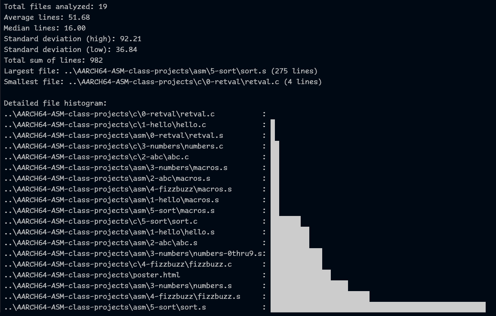
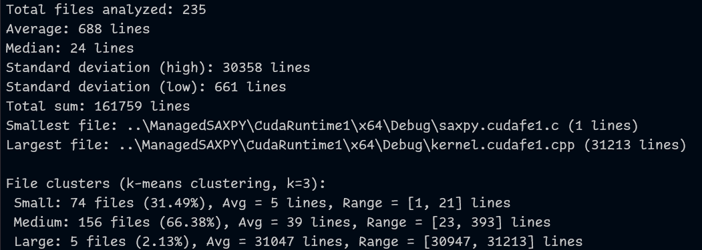

# codesiz

codesiz is a command-line utility written in Go that analyzes source code file lengths.





## Features

- Recursively scans a directory for developer-interesting source files.
- Uses a JSON scan profile with include and exclude path patterns.
- Honors the root `.gitignore` by default.
- Computes total files, total lines, average, median, smallest/largest files, asymmetric standard deviations, and optional k-means file size clusters.
- Writes text, JSON, or histogram output.
- Supports ad hoc include/exclude patterns from the command line.

## Usage

```sh
codesiz [options] <path>
```

Common examples:

```sh
codesiz .
codesiz --list --sort lines .
codesiz --format histogram --sort lines .
codesiz --format json --output report.json .
codesiz --include "**/*.go,**/*.md" --exclude "vendor/**" .
codesiz --drop-largest 2 .
codesiz --all --exclude ".git/**,node_modules/**" .
```

Options:

```text
--all                 scan all regular files instead of profile includes
--config <file>       scan profile JSON file (default "languages.json")
--drop-largest <n>    exclude the largest n files from analysis
--exclude <pattern>   exclude glob pattern; repeat or use commas
--format <format>     output format: text, json, histogram (default "text")
--histogram           alias for --format histogram
--include <pattern>   include glob pattern; repeat or use commas
--list                include per-file details
--no-clusters         hide k-means file size clusters
--output <file>       write output to a file instead of stdout
--sort <mode>         sort file details: none, path, lines (default "none")
-h, --help            print help
-?                    print help
```

## Scan Profile

The default profile is `languages.json`. It is intentionally a scan profile, not a language registry: it describes which files are usually useful for source-size analysis and which files are usually noise.

```json
{
  "include": [
    "**/*.go",
    "**/*.py",
    "**/*.ts"
  ],
  "exclude": [
    ".git/**",
    "node_modules/**",
    "**/*.generated.*",
    "**/*.min.js"
  ]
}
```

Pattern notes:

- `**/*.go` matches files by extension anywhere under the scanned path.
- `vendor/**` matches a directory at the scan root.
- `**/vendor/**` matches nested vendor directories.
- `*.md` matches a file name in any directory.
- Exclude patterns win over include patterns.
- Command-line `--include` patterns replace the profile includes for that run.
- Command-line `--exclude` patterns are added to the profile excludes.

codesiz also reads `.gitignore` from the scanned root and skips ignored files and directories before applying the scan profile.

## Building

```sh
go build -o codesiz.exe main.go
```

On Linux/macOS:

```sh
go build -o codesiz main.go
```

## Testing

```sh
go test ./...
```
